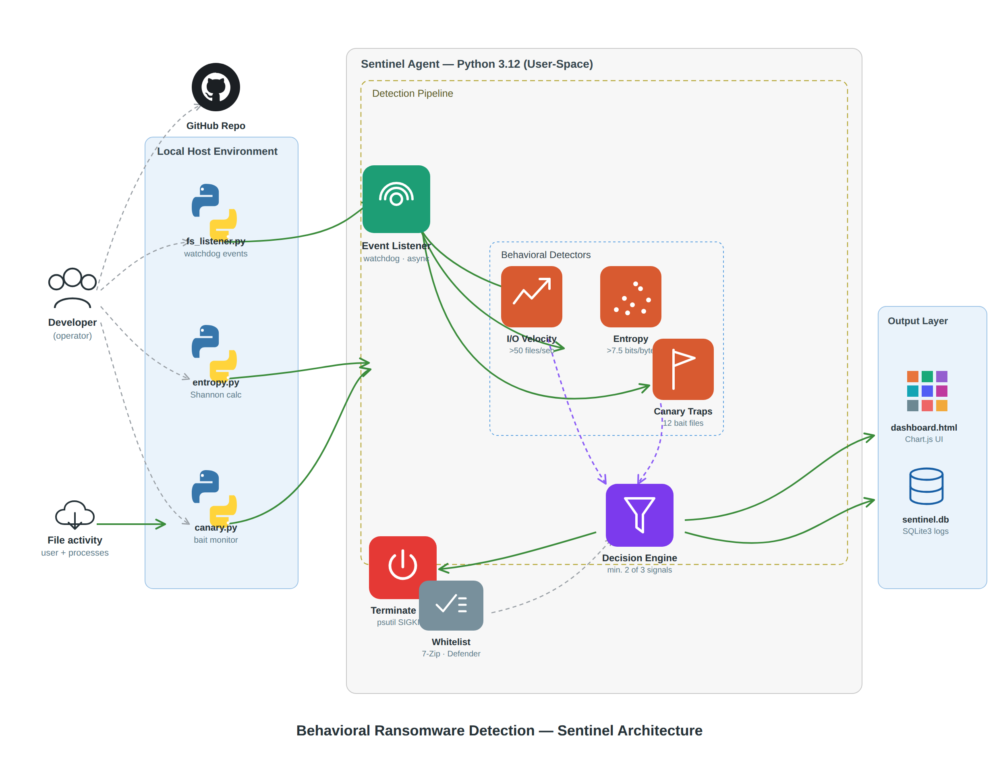

<div align="center">

# Project Sentinel

### Behavioral Ransomware Detection: Creating an Early Warning System for Endpoints

[](https://github.com/anakataa/sentinel-ransomware/actions/workflows/ci.yml)
[](https://github.com/anakataa/sentinel-ransomware/releases/latest)
[](https://python.org)
[]()
[](LICENSE)

_A lightweight, offline endpoint agent that detects ransomware by what it **does**, not by what it's called._

**[Website & download](https://anakataa.github.io/sentinel-ransomware/)** · [Results](docs/results.md) · [Testing guide](docs/sandbox.md) · [Thesis card](docs/THESIS_CARD.md)

</div>

---

Signature-based antivirus misses new ransomware; enterprise EDR catches it but is too expensive and heavy for small businesses and old hardware. Sentinel is a free, user-space Python agent that watches file activity, recognises encryption behavior and stops the process responsible — with no cloud, no telemetry and no kernel driver.

Diploma thesis project · Information Technology · Collegium Da Vinci, Poznań · supervisor Tomasz Tyksiński.

## How it works

Three independent detectors; **two must agree** before the agent acts.

| Signal | What it catches | Threshold |
|---|---|---|
| **File velocity** | Mass file changes no person produces | > 50 files/s (sliding window) |
| **Shannon entropy** | Written data that looks like ciphertext | > 7.5 of 8 bits/byte |
| **Bait files** | Hidden decoys that no legitimate program opens | any write / rename / delete |

After a verdict the agent identifies **which process is writing** (its write and read volume must match the observed file changes in two consecutive windows) and terminates it via `psutil`. If no process matches clearly, or the match is a trusted program (7-Zip, WinRAR, backup tools), it only raises an alert. Every event is stored in a local SQLite audit log.

<div align="center">



</div>

## Results

Built-in simulator, 400 documents, 3 runs per scenario, on clean virtual machines ([full data and method](docs/results.md)):

| Simulator speed | Windows Server 2025 VM | Ubuntu 22.04 VM |
|---|---|---|
| 20 files/s | stopped, 5.1 % of files lost | stopped, 3.5 % lost |
| 100 files/s | stopped, 17 % lost | stopped, 17 % lost |
| 400 files/s | stopped, 57 % lost | stopped, 58 % lost |
| unthrottled (~650–850 files/s) | detected, not stopped | detected, not stopped |
| normal editing, copying, zip | no alerts | no alerts |
| in-place gzip compression | flagged (known false positive) | flagged |
| idle CPU / memory | 0.1 % / ~25 MB | 0.5 % / ~25 MB |

Detection takes 0.03–0.06 s; stopping the process takes about 1 s because attribution must be confirmed first. An unthrottled attack on a fast machine finishes within that second — the main measured limitation of a user-space design.

## Quick start

**Windows, no Python needed:** download `sentinel-windows-x64.zip` from the [latest release](https://github.com/anakataa/sentinel-ransomware/releases/latest), unzip, then:

```powershell
.\sentinel.exe demo                                                   # safe sandbox + live dashboard
.\sentinel.exe run --watch "$env:USERPROFILE\Documents" --monitor-only # alerts only
.\sentinel.exe run --watch "$env:USERPROFILE\Documents"                # alerts + stop the process
.\sentinel.exe audit -n 20                                            # what happened
```

**From source (Windows or Linux):**

```bash
git clone https://github.com/anakataa/sentinel-ransomware.git && cd sentinel-ransomware
pip install -e ".[dev]"
python -m sentinel demo
```

`demo` creates its own sandbox of synthetic documents, opens the dashboard at `http://127.0.0.1:8765/` and lets you launch the simulator with a button. It only watches the sandbox and only ever stops the simulator it launched itself. Start on a real machine with `--monitor-only` for a day before enabling termination.

## Testing

```bash
pytest                                                    # unit + end-to-end tests
python scripts/vm/run_matrix.py --runs 3                  # evaluation matrix -> results/<host>/summary.md
```

- **CI** ([`ci.yml`](.github/workflows/ci.yml)): tests on fresh Windows and Ubuntu VMs with Python 3.10 and 3.12, then the evaluation matrix on both, on every push.
- **Release** ([`release.yml`](.github/workflows/release.yml)): on a `v*` tag, builds `sentinel.exe`, smoke-tests it on a clean Windows VM (demo → attack → stop) and publishes the release.
- **Website** ([`pages.yml`](.github/workflows/pages.yml)): publishes `site/` to GitHub Pages.
- **Manual VirtualBox runs:** [`docs/sandbox.md`](docs/sandbox.md).

The simulator `scripts/mock_ransomware.py` is harmless: it only operates inside a sandbox folder it created and marked itself.

## Project structure

```
src/sentinel/        agent: event_listener, velocity, entropy, canary, decision,
                     attribution, mitigation, audit, config, agent, dashboard, CLI
dashboard/           live dashboard (HTML + Chart.js)
scripts/             mock_ransomware.py, vm/run_matrix.py, vm/smoke_exe.py
tests/               unit and end-to-end tests
packaging/           PyInstaller spec for sentinel.exe
site/                download website
docs/                results, testing guide, thesis card, original proposal
.github/workflows/   CI, release, website
```

## Limitations

- An unthrottled attack on a fast machine can finish before the culprit is confirmed (about 1 s); it is detected and logged but not stopped.
- Rewriting many files as compressed data (e.g. in-place gzip) looks like ransomware; trusted programs are matched by name only so far.
- User-space only: no kernel driver, so reading a bait file is not visible — only writes, renames and deletes.
- A research prototype. It limits damage; it cannot decrypt files. Keep backups.

## License

[Apache 2.0](LICENSE)
